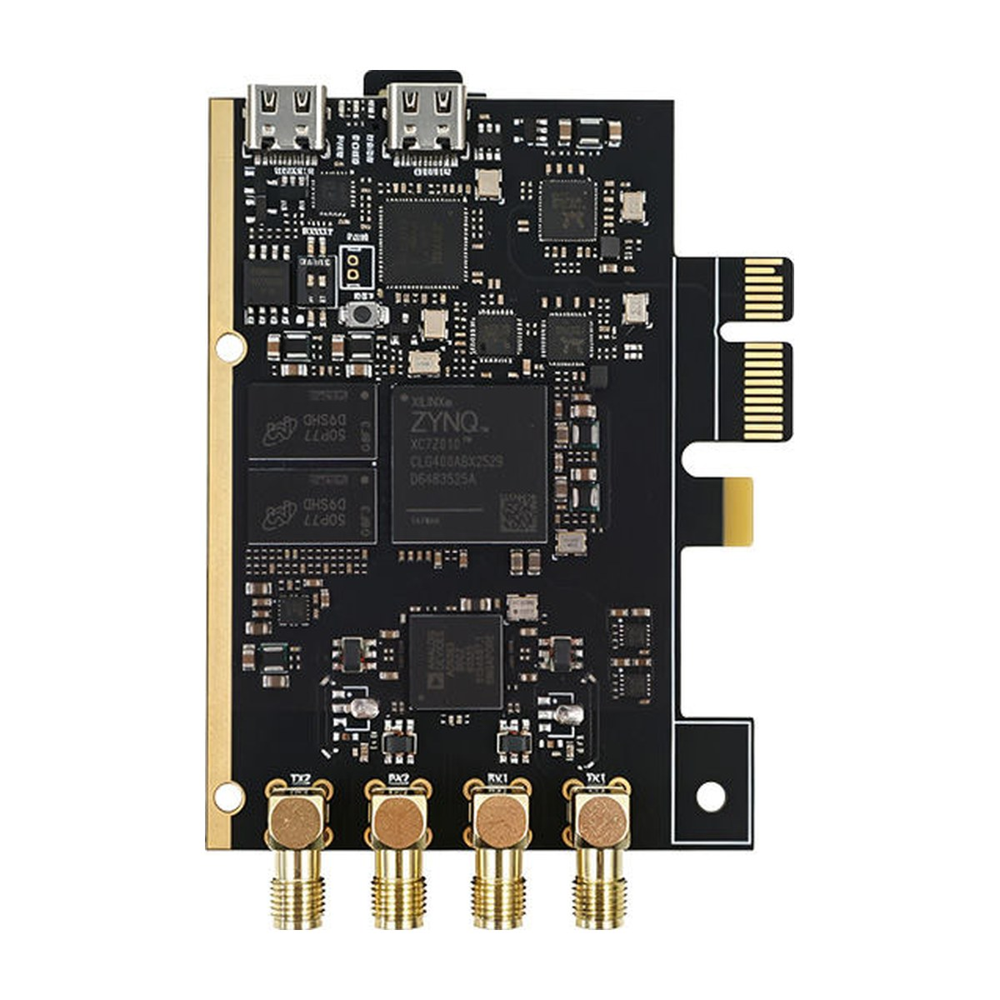
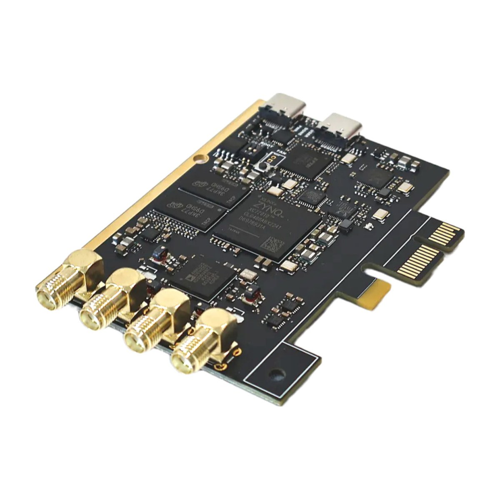

# PCIE_7010_SDR

Schematic, firmware and documentation for the **OpenSourceSDRLab PCIE Version PlutoSDR** (PCIE_7010_SDR), a PlutoSDR-compatible software-defined radio on a PCI Express card, with a Xilinx Zynq-7010 SoC and the Analog Devices AD9363 RF transceiver (70 MHz – 6 GHz).

  
  

## Product link

<https://opensourcesdrlab.com/products/opensourcesdrlab-pcie-version-plutosdr-ad9363-xc7z010>

## About the board

- RF transceiver: Analog Devices **AD9363**, two transmit and two receive channels on SMA connectors (TX1, RX1, TX2, RX2), 0.5 ppm TCXO
- SoC: Xilinx **Zynq-7010** (XC7Z010, CLG400 package), DDR3 memory, Quad-SPI flash, microSD card slot
- **PCI Express x1** interface: a Realtek RTL8111F PCIe Gigabit Ethernet controller on the card is connected directly to the Zynq's RTL8211F Ethernet PHY, so the PC sees the radio as a network card. Default board address `192.168.3.10`.
- USB: two USB-C ports; USB 2.0 (USB3320 PHY, the PlutoSDR USB interface, can power the board) and an FT2232H JTAG and serial-console bridge
- Firmware: Analog Devices PlutoSDR firmware **v0.38**, adapted to this board (Ethernet and USB); works with IIO Oscilloscope, GNU Radio, MATLAB and other PlutoSDR software
- Designed to stay inside a PC case; the card has no fan of its own and is cooled by the case air flow

## Quick start

1. Install the PlutoSDR USB drivers from Analog Devices and, if Windows does not find one, the Realtek RTL8111F network driver.
2. Plug the card into a PCIe slot (or connect its USB port). Give the new network adapter an address in `192.168.3.x`, for example `192.168.3.100`.
3. Open IIO Oscilloscope and connect to `ip:192.168.3.10`.

The full steps are in the **[Quick Start Guide](docs/Quick-Start-Guide.md)** ([PDF](docs/Quick-Start-Guide.pdf)).

## Repository layout

| Path | Contents |
|---|---|
| `hardware/` | Board schematic (PDF) |
| `docs/` | Quick Start Guide (Markdown and PDF) and its pictures |
| `images/` | Product photos |

## Downloads (Releases)

Large files are attached to the [Releases](../../releases) page instead of being stored in the repository:

| File | Contents |
|---|---|
| `PCIE_7010_SDR_firmware_v0.38.zip` | Factory firmware v0.38: `flash_firmware/` (`pluto.dfu`, `uboot-env.dfu` for DFU update; `boot.bin`, `fsbl.elf` for flash recovery) and `SD_img/` (files for booting from a microSD card) |
| `SHA256SUMS.txt` | SHA-256 checksums of the files above |

Check a download with `shasum -a 256 -c SHA256SUMS.txt` (macOS / Linux) or `certutil -hashfile <file> SHA256` (Windows).

## Licence

Files created by OpenSourceSDRLab are released under the [Apache License 2.0](LICENSE). The firmware is built from the Analog Devices PlutoSDR firmware and contains Linux, U-Boot, Buildroot and other open-source software under their own licences (mostly GPL); see [NOTICE.md](NOTICE.md), which also explains how to obtain the corresponding source code.

## Support

- Email: support@opensourcesdrlab.com
- Forum: <https://forum.opensourcesdrlab.com>
- Discord: <https://discord.gg/nnxY6DkmvT>
- Blog and user manuals: <https://blog.opensourcesdrlab.com>

---
© 2026 OpenSourceSDRLab. All rights reserved. · <a href="https://www.opensourcesdrlab.com">www.opensourcesdrlab.com</a>
