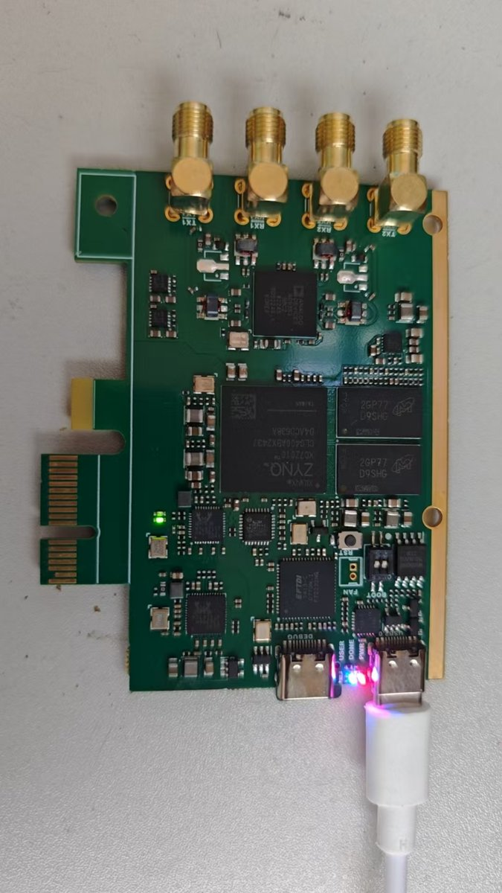
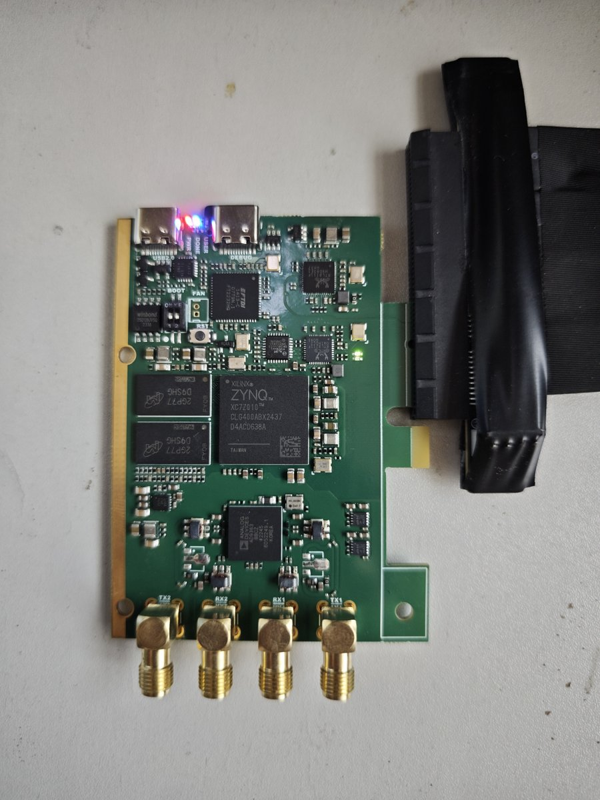
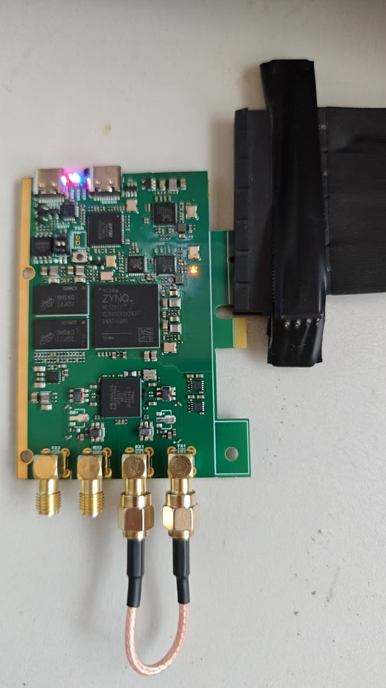
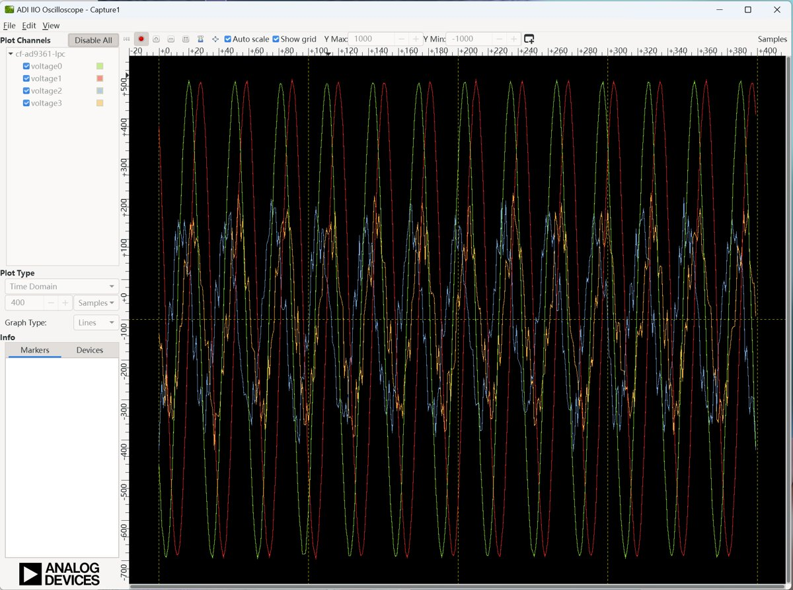

<!-- ossl:header -->
<p><a href="https://www.opensourcesdrlab.com"></a></p>

# PCIE_7010_SDR Quick Start Guide

| Product | Document | Version | Date |
|---|---|---|---|
| PCIE_7010_SDR | OSSDRLAB-PCIE_7010_SDR-QSG | 1.0 | 2026-11-12 |
<!-- /ossl:header -->

## 1. Overview

The PCIE Version PlutoSDR (PCIE_7010_SDR) is a PlutoSDR-compatible software-defined radio on a PCI Express card: a Xilinx Zynq-7010 SoC and the Analog Devices AD9363 RF transceiver with two transmit and two receive channels. It improves on the professional-edition PlutoSDR board: the Zynq's Gigabit Ethernet PHY is wired directly to a Realtek RTL8111F PCIe Ethernet controller on the card, so the PC sees the radio as a network card. It is meant for long-term use inside a PC case; it has no fan of its own and is cooled by the case air flow.

The card can also be used over USB like an ADALM-PLUTO. It comes with the Analog Devices PlutoSDR firmware v0.38 (adapted to this board) pre-installed. The factory network address of the card is **192.168.3.10**.

## 2. What you need

| Item | Notes |
|---|---|
| PCIE_7010_SDR card | |
| PC with a free PCIe slot (x1 or larger) | or a USB-C cable for USB use |
| SMA cable and attenuator | optional, for a TX → RX loop-back test (use 20 dB or more) |
| PlutoSDR USB drivers (Windows) | Analog Devices: <https://wiki.analog.com/university/tools/pluto/drivers/windows>; the package also installs `dfu-util` |
| RTL8111F network driver | usually included in Windows 10/11 and Linux; otherwise from Realtek: <https://www.realtek.com/Download/List?cate_id=584> |
| IIO Oscilloscope | Analog Devices: <https://wiki.analog.com/resources/tools-software/linux-software/iio_oscilloscope> |
| Firmware | `PCIE_7010_SDR_firmware_v0.38.zip` from the [Releases](../../../releases) page (only for update or recovery) |

## 3. Board connectors

| Connector | Function |
|---|---|
| TX1, TX2 (SMA) | transmit outputs |
| RX1, RX2 (SMA) | receive inputs |
| PCIe x1 edge connector | power and the RTL8111F PCIe Gigabit Ethernet controller |
| USB-C (USB) | USB 2.0 device port of the Zynq: PlutoSDR network adapter, mass-storage drive and serial console; can power the card |
| USB-C (JTAG) | FT2232H bridge: JTAG and a serial console |
| microSD slot | optional boot from a microSD card |

See `hardware/PCIE_7010_SDR_Schematic.pdf` for the full schematic.

## 4. Installing the drivers

1. Install the PlutoSDR USB drivers from Analog Devices (Windows): run the installer and accept the defaults.

2. If the PC does not show a network adapter for the card after it is installed (section 6), install the Realtek RTL8111F driver for your operating system.

## 5. Test over USB

1. Connect the card's USB port to the PC (the card does not need to be in a PCIe slot for this test).

   

2. After about 30 seconds the PC finds a PlutoSDR device. Start IIO Oscilloscope; it finds the device (or enter `ip:192.168.2.1`). Click **Connect**.

## 6. Test over PCI Express

1. Switch the PC off, insert the card into a PCIe slot and switch the PC on.

   

2. The PC shows a new wired network adapter (Realtek PCIe GbE Family Controller). Set its IPv4 address manually to an address in the same network as the card, for example IP address `192.168.3.100`, subnet mask `255.255.255.0`.

3. Check the connection: `ping 192.168.3.10`.

4. Start IIO Oscilloscope and connect to `ip:192.168.3.10`.

## 7. Loop-back test

1. Connect TX1 to RX1 with an SMA cable and an attenuator of at least 20 dB.

   

2. In IIO Oscilloscope, set the TX LO and RX LO to the same frequency, enable the DDS tone on TX1, and open **Plot** → **Capture**. The received channels show the tone:

   

## 8. Updating the firmware

The firmware update uses DFU over the USB port, as on an ADALM-PLUTO.

1. Unzip `PCIE_7010_SDR_firmware_v0.38.zip`.

2. Connect the USB port and start the card in DFU mode: log in to the running card (`ssh root@192.168.2.1`, default password `analog`) and run `device_reboot sf`. Windows shows a **USB download gadget** in the Device Manager.

3. In a command window, go to `flash_firmware` and run `dfu-util` (on Windows it is installed with the PlutoSDR drivers):

```
dfu-util -d 0456:b673,0456:b674 -D pluto.dfu -a firmware.dfu
dfu-util -d 0456:b673,0456:b674 -D uboot-env.dfu -a uboot-env.dfu
```

   The folder path must not contain non-ASCII characters.

4. When both commands have finished, power-cycle the card.

If the card no longer starts at all, write `boot.bin` to the Quad-SPI flash over JTAG with the Vivado Hardware Manager (Zynq FSBL `fsbl.elf`), then repeat the DFU update.

### Booting from a microSD card

The `SD_img` folder contains the files for booting from a microSD card (`BOOT.bin`, `devicetree.dtb`, `uImage`, `uramdisk.image.gz`, `uEnv.txt`). Copy them to the first partition (FAT32) of a microSD card, insert it and set the card to SD boot.

## 9. Support

- Email: support@opensourcesdrlab.com
- Forum: <https://forum.opensourcesdrlab.com>
- Discord: <https://discord.gg/nnxY6DkmvT>
- Blog and user manuals: <https://blog.opensourcesdrlab.com>

<!-- ossl:footer -->
---
<sub>© 2026 OpenSourceSDRLab. All rights reserved. · <a href="https://www.opensourcesdrlab.com">www.opensourcesdrlab.com</a></sub>
<!-- /ossl:footer -->
